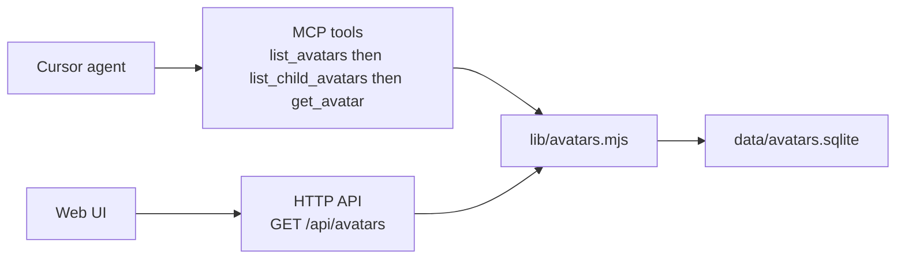

# Avatar stances

People already ask an assistant to take a stance: a way of seeing, a way of speaking, a set of things it cares about, a set of things it ignores. Those identities live in the user's intent. This product makes them exist for the assistant too.

Two surfaces, one SQL table, two levels (generic → child):

1. **UI** talks to the table over **HTTP**.
2. **Cursor** talks to the table over **MCP tools**.

The agent is not a terminal. It does not run file paths to fetch avatars.



## What an avatar is

An avatar is a stance, not a job title. “Doctor” can be a name. It does not make the assistant a doctor. These fields do:

| Column | Job |
|---|---|
| `parent_id` | `NULL` = generic. Set = child of that generic. No grandchildren. |
| `triggers` | **Choose** the avatar, by meaning. Generics first, then children of the winner. |
| `name` | Identity, and an explicit override (`as Clinician`, `as Cardiologist`). |
| `lens` | What it looks for first. Child answers use generic lens, then child lens. |
| `cares` / `ignores` | Attention budget once chosen. A child **unions** these with its generic parent (Cardiologist still uses Doctor cares/ignores). |
| `voice` | How it speaks. Child answers use generic voice, then child voice. |
| `needs` | Facts the answer depends on. If one that matters is missing, the assistant asks one short question first and does not guess. A child adds its needs to the generic's. |
| `format` | Shape of the answer (sections, steps vs prose, code blocks). A child's format replaces the generic's; if empty, the generic's is used. |
| `intensity` | How far those features reshape the answer (tint / lean / inhabit). |

Seed: 100 generic jobs, each with 5 children (500 specialists). The first 20 live in `db/seed.mjs`, `db/seed-children.mjs`, and `db/seed-guidance.mjs`; the other 80 live in `db/seed-extended/`, one file per field, each generic written next to its children.

## How the assistant uses them

1. Call MCP **`list_avatars`** — generic rows as `id`, `name`, `triggers` (about 100).
2. Compare the request to the generic triggers **by meaning**, not shared words ("my tummy aches" relates to Doctor; "returns the wrong chunks" does not relate to Investor's "returns"). The generic with the most strongly related triggers wins.
3. Call MCP **`list_child_avatars`** with that generic id (5–10 children) and compare the same way. If none relates, keep the generic.
4. Call MCP **`get_avatar`** with the winning id — full row. A child includes `parent` and `applied` (parent fields merged with the child).
5. Answer from **`applied`**. A child does not replace the generic; it adds specialty on top of the generic’s cares, ignores, lens, voice, and needs. Ask first if a `needs` fact is missing; then answer in `format`.
6. If no generic relates, call **`create_avatar`** from this request and answer as that new row in the same turn.

Comparing 100 generics and then one family's children costs about a third of comparing all 600 triggers at once. Tool replies are compact JSON.

The procedure lives in `.cursor/skills/use-avatar-stance/SKILL.md`. The connection to the database is the MCP server in `mcp/server.mjs`, configured in `.cursor/mcp.json`.

Enable the **avatar-stances** server in Cursor Settings → MCP if it is not already on.

## Run it on a laptop

### 1. Requirements

- **Node.js 24** (tested on 24.22). Node 22.13+ also works. The database uses Node's built-in `node:sqlite`, so there is **no `npm install`** and no `node_modules`.
- **Cursor**, for the assistant part.

Check with `node --version`.

### 2. Create the database

From the project folder:

```bash
node scripts/init-db.mjs
```

This creates `data/avatars.sqlite` and seeds 600 avatars: 100 generics with 5 children each. Running it again keeps existing rows. Other options:

```bash
node scripts/init-db.mjs --reset        # wipe and reseed
node scripts/init-db.mjs --add-missing  # add seed rows that are missing, keep your edits
node scripts/check-seed.mjs             # verify: 100 generics, 5 children each, all fields filled
```

### 3. Open the UI

```bash
node server/index.mjs
```

Open [http://127.0.0.1:3333](http://127.0.0.1:3333) (another port: `PORT=4000 node server/index.mjs`). The left panel is the tree of generics and their children; select one to view and edit every field (lens, voice, cares, ignores, triggers, needs, format, intensity), create a generic or a child, or delete. Changes are saved to the same SQLite file the assistant reads.

### 4. Connect the assistant in Cursor

1. Open the **project folder** in Cursor (File → Open Folder). `.cursor/mcp.json` registers the `avatar-stances` MCP server; it starts `node mcp/server.mjs` itself, so no terminal is needed.
2. Cursor Settings → **MCP** → turn **avatar-stances** on. It should list 4 tools: `list_avatars`, `list_child_avatars`, `get_avatar`, `create_avatar`. If it shows an old list, toggle it off and on.
3. The always-on rule `.cursor/rules/avatar-stances.mdc` makes the agent follow `.cursor/skills/use-avatar-stance/SKILL.md` on every request.
4. Start a **new chat** in Agent mode and ask anything, for example:
   - `My knee hurts after running` → Sports Physio under Physiotherapist
   - `I am 20 weeks pregnant and feel dizzy` → Prenatal Midwife under Midwife
   - `My bees are swarming, how do I requeen?` → no avatar fits, so it creates Beekeeper and answers as it
   - `as Cardiologist: …` → uses that avatar directly

   The first line of the reply names the avatar (`Answering as <child> under <parent> (intensity <n>).`). If a fact the avatar needs is missing, it asks one short question first.

The MCP server works out its paths from its own file, so it can be started from any folder. If `node` is not on Cursor's PATH, put the full path from `which node` in `command` in `.cursor/mcp.json`.

### 5. Run the checks

Each check copies the database to a temporary file first, so it never changes your data.

```bash
node mcp/self-check.mjs           # MCP handshake, 4 tools, Cardiologist loads with Doctor merged in
node mcp/child-answer-check.mjs   # 5 children: parent + child fields merged; asks vs direct answers
node mcp/conflict-check.mjs       # child wins over parent on conflicting fields
node mcp/scenario-check.mjs       # create a generic on a miss; create a child under Doctor
node mcp/route-check.mjs          # whole-word matching and negation ("not pregnant")
node mcp/meaning-check.mjs        # word matching vs the agent's meaning-based picks, 28 requests
```

On a fresh database `meaning-check.mjs` reports 14/28 agreement; it was 16/28 on the development database, where the agent had already created Ophthalmologist (under Doctor) and Exam Cram Tutor (under Teacher) during chats. Matching by meaning is done by the agent in Cursor, not by a script. The scripts check the data, the tools, and the parent–child merge; `meaning-check.mjs` shows where plain word matching falls short.

Vanilla HTML/CSS/JS (no Aerocraft/Bear): this is a standalone take-home, not a Dox Cover app.

## What v1 leaves out

- Markdown-per-avatar (listing would be N reads).
- Vector search (the product is compare-every-trigger-set).
- A second chatbot in the UI (Cursor is the assistant).
- Asking before creating on a miss (the miss path answers in this turn).
- Grandchildren (a child cannot have children).

## Stack

Vanilla UI + Node stdlib HTTP for the browser. A stdio MCP server for the agent. Both call the same `lib/avatars.mjs` against the same SQLite file.
